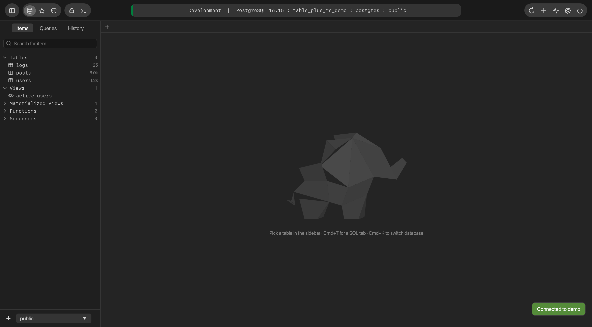

# table-plus-rs

A fast, native PostgreSQL desktop client for macOS, built in **pure Rust** with egui.

## Screenshots

| | |
|---|---|
|  **Start screen**: saved connections with color tags and environment badges, search |  **Table data**: virtualised grid, sort, filters, pagination |
|  **Staged edits**: changed cells are highlighted until you commit |  **Preview SQL**: review the exact statements, committed in one transaction |
|  **Structure**: edit columns, types, defaults and comments as previewable DDL |  **Indexes**: list, create and drop |
|  **SQL editor**: highlighting, schema-aware autocomplete, results grid, export |  **Loading**: the status pill fills with the connection's color while a query runs |
|  **Workspace**: grouped toolbar, centred status pill, the elephant until you open a tab |  **Settings**: page size, count estimate threshold, editor font size |

The screenshots are generated by the app itself against a seeded demo database; see
[Regenerating the screenshots](#regenerating-the-screenshots).

## Features

- Connections: grouped list, colour tags, environment badges, import from `postgresql://` URL, test before save, passwords stored in `connections.json` (mode 0600), never in the Keychain, so no macOS password prompts
- Workspace: items sidebar (tables, views, materialized views, functions, sequences) with search and schema switcher; saved queries; per-connection history
- Table data: virtualized grid, sort (shift-click for multi), filters (16 operators + raw SQL), quick filter, pagination, FK follow (`→`)
- Editing: inline cell edit, add / duplicate / delete rows, set NULL / DEFAULT, preview SQL, commit in one transaction (PK or ctid identity)
- Structure: edit name / type / nullable / default / comment, add/drop columns, table comment, drop foreign keys and checks, view triggers — all as previewable DDL
- Indexes: list with size/predicate, create (btree/hash/gin/gist/brin), drop
- DDL view for tables, views, functions; sequence details
- SQL editor: PostgreSQL syntax highlighting, schema-aware autocompletion, run current statement (`⌘⏎`) / run all (`⌘⇧⏎`), cancel, multi-result tabs, error detail/hint/position, export CSV/JSON/SQL/Markdown, save to favourites, open/save `.sql`
- Tools: process list (cancel/terminate backends), create table, rename/truncate/drop, refresh materialized view
- Look: one fixed dark theme, see [Colors and fonts](#colors-and-fonts)

## Development

```sh
cargo run -p table-plus-rs          # run the app
scripts/bundle-macos.sh             # release build wrapped in target/release/bundle/table-plus-rs.app
cargo test                          # colors, editor, grid-model, SQL generation and backend tests
```

The workspace has two crates: `crates/core` (the PostgreSQL engine: sessions, catalog queries, SQL
generation, storage; no UI code) and `crates/app` (the egui interface).

The backend integration tests need a live database. Load the demo data and point the tests at it:

```sh
createdb table_plus_rs_demo && psql table_plus_rs_demo -f crates/core/tests/seed.sql
TABLE_PLUS_RS_TEST_HOST=127.0.0.1 TABLE_PLUS_RS_TEST_PORT=5432 TABLE_PLUS_RS_TEST_DB=table_plus_rs_demo \
  TABLE_PLUS_RS_TEST_SSL=disable cargo test -p table-plus-core
```

Data lives in `~/Library/Application Support/dev.zeeshan.table-plus-rs/`
(`connections.json`, `settings.json`, `favorites.json`, `history/<connection>.jsonl`).

## Colors and fonts

There is a single dark look. All colors live in one table, `tableplus()` in
`crates/app/src/theme.rs`.

| Surface | Color |
|---|---|
| Toolbar and window | `#1a1a1a`, icon groups `#3a3a3a` |
| Sidebar | `#1f1f1f`, selected row `#005ad1` (macOS selection blue) |
| Grid rows | `#1e1e1e` / `#2e2e2e` alternating, header `#242424`, column lines `#353535` |
| Editor, tab strip, bottom bars | `#242424`, buttons `#343434`, selected segment `#117dff` |
| Text | `#d6d6d6`, secondary `#7f7f7f`, `NULL` `#434343` |
| SQL | keywords `#529bd8`, strings `#ca6e6e`, quoted names `#e04978`, numbers `#b57aff`, comments `#009b31` |

Fonts are the macOS system fonts: SF Pro 13 for the interface and SF Mono 12 for data, sidebar
items, the SQL editor and the status pill. Connection color tags have five presets.

## Keyboard shortcuts

| Action | Keys |
|---|---|
| Commit changes | ⌘S |
| Preview SQL | ⌘⇧P |
| Discard | ⌘Esc |
| Add row | ⌘I |
| Duplicate rows | ⌘D |
| Delete rows | ⌘⌫ |
| Run current / all | ⌘⏎ / ⌘⇧⏎ |
| Reload | ⌘R |
| Reconnect | ⌘⇧R |
| Open database | ⌘K |
| New SQL tab / close tab | ⌘T / ⌘W |
| Process list | ⌘. |
| Data / Structure / Index | ⌘⇧1 / 2 / 3 |
| Toggle sidebar | ⌘\ |

## Regenerating the screenshots

`TABLE_PLUS_RS_SHOTS` switches the app into a scripted run: it seeds a `demo` connection, walks through
the screens above and saves egui's own captures (no screen-recording permission needed). Use a scratch
config directory so your real connections are untouched:

```sh
TABLE_PLUS_RS_HOME=/tmp/tpr-demo TABLE_PLUS_RS_SHOTS=docs/screenshots \
TABLE_PLUS_RS_SHOT_DB=127.0.0.1:5432/table_plus_rs_demo cargo run -p table-plus-rs
```
