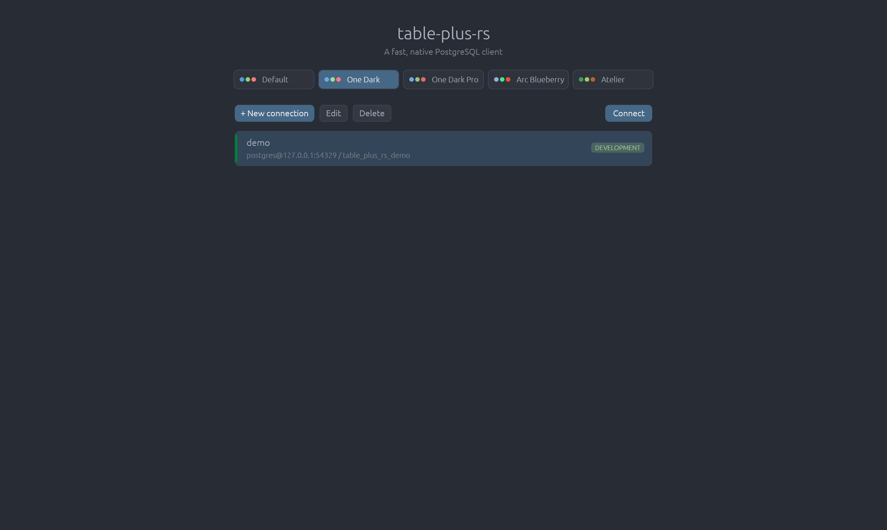
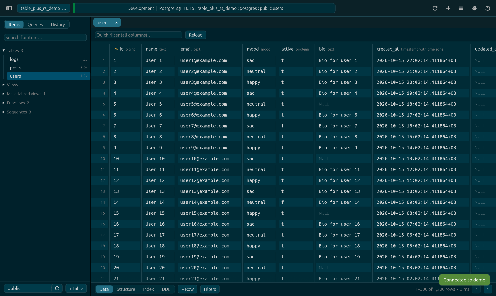
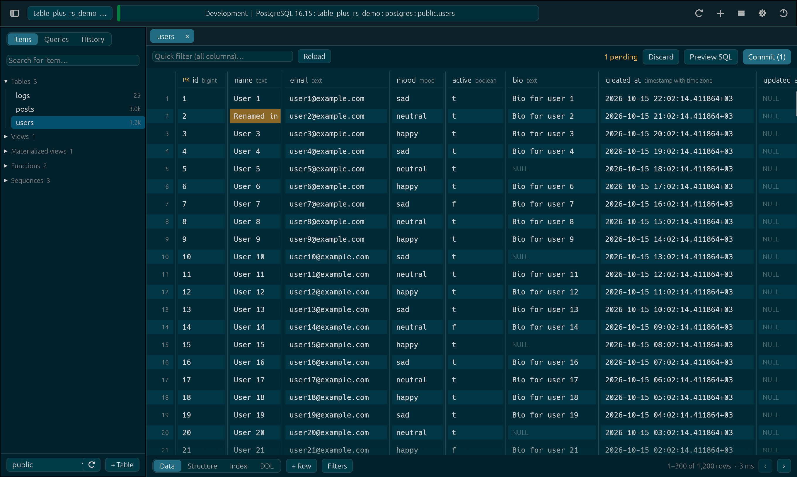
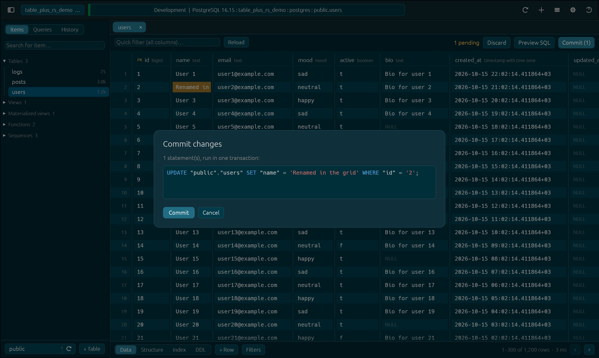
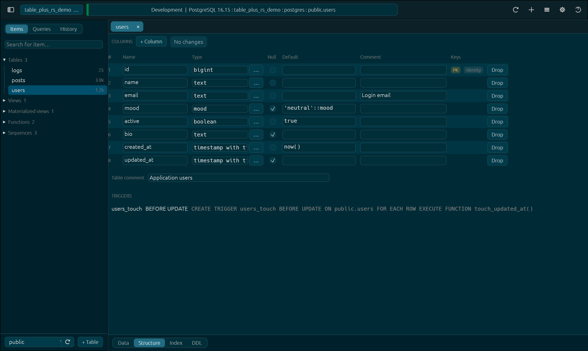
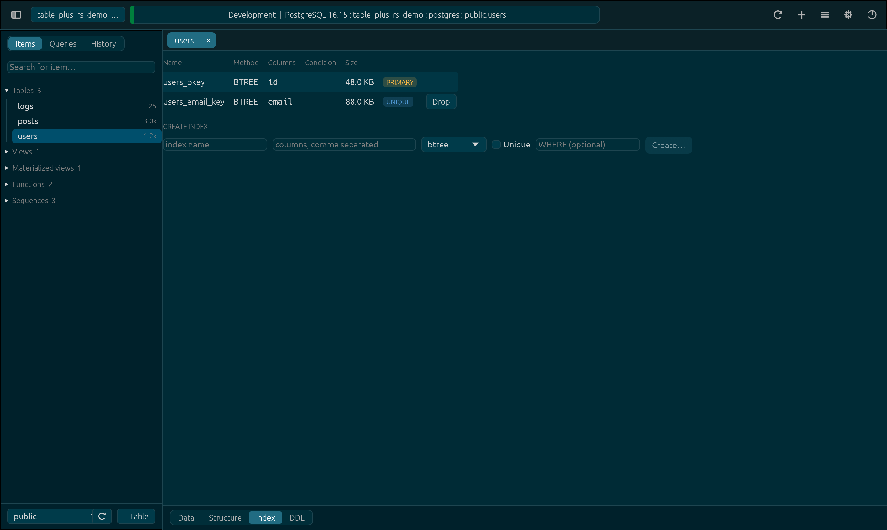
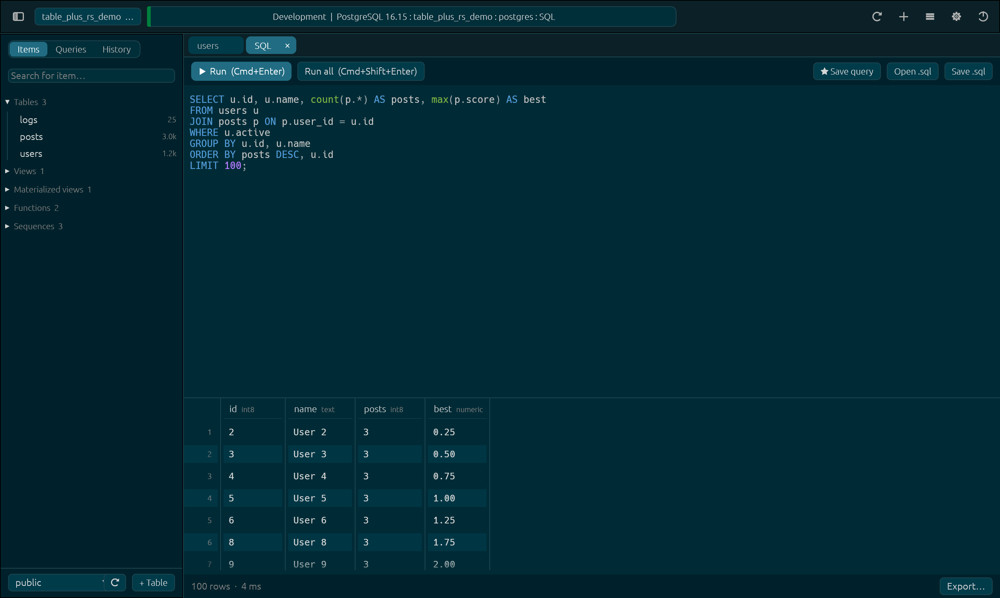
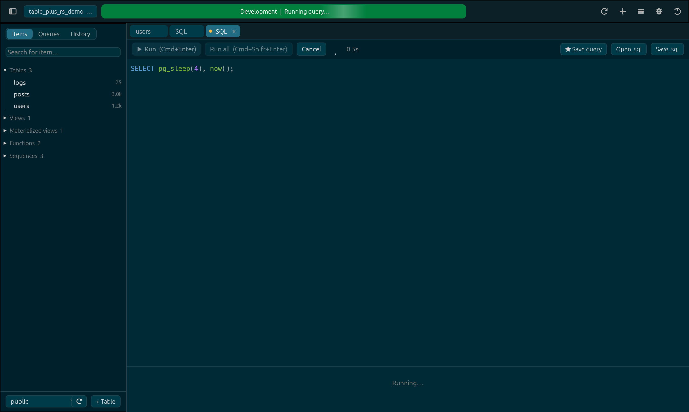
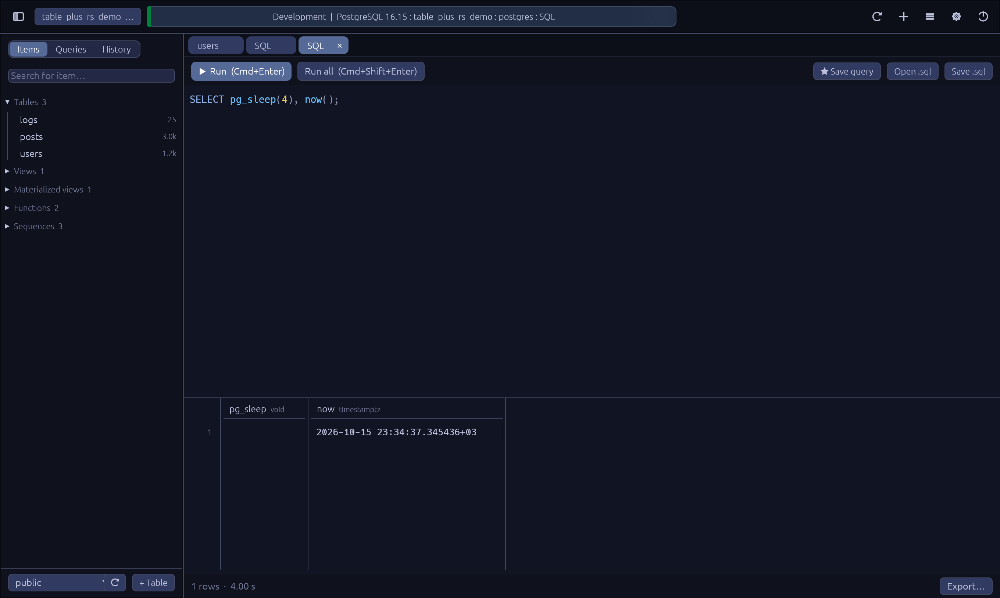
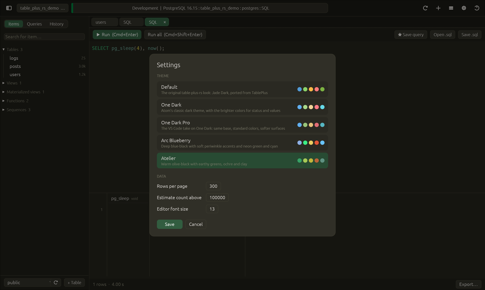

# table-plus-rs

A fast, native PostgreSQL desktop client for macOS, built in **pure Rust** (egui, no webview,
no JavaScript or TypeScript) and modelled on TablePlus (reverse-engineered with REA; see
[`docs/REVERSE_ENGINEERING.md`](docs/REVERSE_ENGINEERING.md)).

## Screenshots

| | |
|---|---|
|  **Start screen**: saved connections, with a theme picker on top |  **Table data**: virtualised grid, sort, filters, pagination |
|  **Staged edits**: changed cells are highlighted until you commit |  **Preview SQL**: review the exact statements, committed in one transaction |
|  **Structure**: edit columns, types, defaults and comments as previewable DDL |  **Indexes**: list, create and drop |
|  **SQL editor**: highlighting, schema-aware autocomplete, results grid, export |  **Loading**: the status pill fills with the connection's color while a query runs |
|  **Themes**: Arc Blueberry |  **Settings**: live theme preview (Atelier shown) |

The screenshots are generated by the app itself against a seeded demo database; see
[Regenerating the screenshots](#regenerating-the-screenshots).

## Features

- Connections: grouped list, colour tags, environment badges, import from `postgresql://` URL, test before save, passwords stored in `connections.json` (mode 0600), never in the Keychain, so no macOS password prompts
- Workspace: items sidebar (tables, views, materialized views, functions, sequences) with search and schema switcher; saved queries; per-connection history
- Table data: virtualized grid, sort (shift-click for multi), filters (16 operators + raw SQL), quick filter, pagination, FK follow (`→`)
- Editing: inline cell edit, add / duplicate / delete rows, set NULL / DEFAULT, preview SQL, commit in one transaction (PK or ctid identity)
- Structure: edit name / type / nullable / default / comment, add/drop columns, table comment, drop foreign keys and checks, view triggers — all as previewable DDL
- Indexes: list with size/predicate, create (btree/hash/gin/gist/brin), drop
- DDL view for tables, views, functions; sequence details
- SQL editor: PostgreSQL syntax highlighting, schema-aware autocompletion, run current statement (`⌘⏎`) / run all (`⌘⇧⏎`), cancel, multi-result tabs, error detail/hint/position, export CSV/JSON/SQL/Markdown, save to favourites, open/save `.sql`
- Tools: process list (cancel/terminate backends), create table, rename/truncate/drop, refresh materialized view
- Themes: `default` (TablePlus "Jade Dark") plus One Dark, One Dark Pro, Arc Blueberry and Atelier; live preview in Settings, see [Themes](#themes)

## Development

```sh
cargo run -p table-plus-rs          # run the app
scripts/bundle-macos.sh             # release build wrapped in target/release/bundle/table-plus-rs.app
cargo test                          # theme, editor, grid-model, SQL generation and backend tests
```

The workspace has two crates: `crates/core` (the PostgreSQL engine: sessions, catalog queries, SQL
generation, storage; no UI code) and `crates/app` (the egui interface).

The backend integration tests need a live database. Load the demo data and point the tests at it:

```sh
createdb table_plus_rs_demo && psql table_plus_rs_demo -f crates/core/tests/seed.sql
TABLE_PLUS_RS_TEST_HOST=127.0.0.1 TABLE_PLUS_RS_TEST_PORT=5432 TABLE_PLUS_RS_TEST_DB=table_plus_rs_demo \
  TABLE_PLUS_RS_TEST_SSL=disable cargo test -p table-plus-core
```

Data lives in `~/Library/Application Support/dev.zeeshan.table-plus-rs/`
(`connections.json`, `settings.json`, `favorites.json`, `history/<connection>.jsonl`).

## Themes

| id | look |
|---|---|
| `default` | The original table-plus-rs look: Jade Dark, ported from TablePlus |
| `one-dark` | Atom's classic dark theme, with the brighter colors for status and values |
| `one-dark-pro` | The VS Code take on One Dark: same base, standard colors, softer surfaces |
| `arc-blueberry` | Deep blue-black with soft periwinkle accents and neon green and cyan |
| `atelier` | Warm olive-black with earthy greens, ochre and clay |

Pick one on the start screen or in **Settings** (`⌘,`). Moving through the list previews it live, **Save** keeps it, and
Cancel / Esc puts the old one back. A theme only changes how table-plus-rs looks.

The theme is chosen by, in order: `--theme NAME` on the command line, `$TABLE_PLUS_RS_THEME`, the saved setting,
then `default`.

```sh
open -n table-plus-rs.app --args --theme atelier        # one run, not saved
TABLE_PLUS_RS_THEME=arc-blueberry target/release/table-plus-rs
```

A bad `--theme` is reported in an error toast and the saved theme is used; a bad `$TABLE_PLUS_RS_THEME` or
stale saved name falls back to the default with a warning, so a typo never locks you out. Names are
forgiving: `Omarchy_One Dark Pro_Theme`, `arc blueberry` and `ATELIER` all resolve.

How it works: a theme is ten role colors (`accent good warn bad info dim track cursor text bg`).
`crates/app/src/theme.rs` expands them into every color the UI paints with, and the default theme is
the fixed Jade Dark table, so it cannot drift. `cargo test` checks name matching, selection
order and WCAG contrast for the palettes and for the derived colors (text on every surface, white on
selected tabs and edited rows). To add a theme, append one entry to `THEMES` (default stays first), run
`cargo test`, and if contrast fails lift `dim` or `track` rather than lowering the thresholds.

Palettes are ported from the Omarchy theme repos' `colors.toml` (https://omarchy.org/themes/).

## Keyboard shortcuts

| Action | Keys |
|---|---|
| Commit changes | ⌘S |
| Preview SQL | ⌘⇧P |
| Discard | ⌘Esc |
| Add row | ⌘I |
| Duplicate rows | ⌘D |
| Delete rows | ⌘⌫ |
| Run current / all | ⌘⏎ / ⌘⇧⏎ |
| Reload | ⌘R |
| Reconnect | ⌘⇧R |
| Open database | ⌘K |
| New SQL tab / close tab | ⌘T / ⌘W |
| Process list | ⌘. |
| Data / Structure / Index | ⌘⇧1 / 2 / 3 |
| Toggle sidebar | ⌘\ |

## Regenerating the screenshots

`TABLE_PLUS_RS_SHOTS` switches the app into a scripted run: it seeds a `demo` connection, walks through
the screens above and saves egui's own captures (no screen-recording permission needed). Use a scratch
config directory so your real connections are untouched:

```sh
TABLE_PLUS_RS_HOME=/tmp/tpr-demo TABLE_PLUS_RS_SHOTS=docs/screenshots \
TABLE_PLUS_RS_SHOT_DB=127.0.0.1:5432/table_plus_rs_demo cargo run -p table-plus-rs
```

## Credits

The move from a webview to a pure-Rust UI follows the approach of
[michaelshimeles/tableplus-rs](https://github.com/michaelshimeles/tableplus-rs) (egui/eframe). This
project is Postgres-only and shares no code with it.
